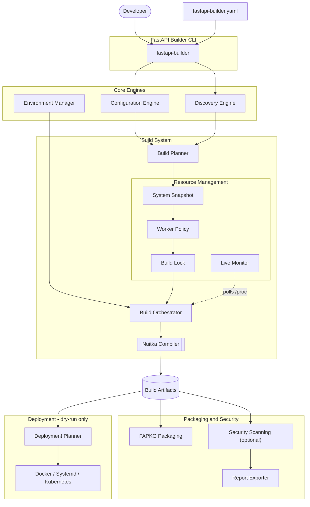
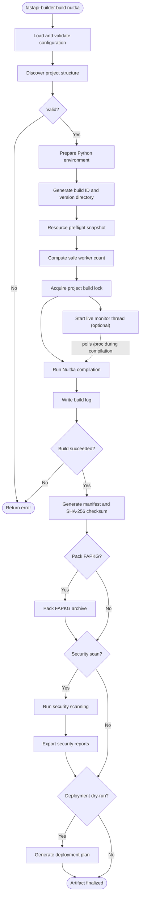

# FastAPI Builder — Architecture

## 1. Overview

FastAPI Builder is a Python-based automation tool designed to simplify building, securing, verifying, and preparing FastAPI applications for deployment.

The project uses a modular architecture where each engine is responsible for a specific stage of the application lifecycle.

---

## 2. High-Level Architecture



### Component Responsibilities

**FastAPI Builder CLI** — `fastapi-builder` is the single entry point for all commands. It routes invocations to the appropriate engine and serialises results to JSON for scripting.

**Configuration Engine** — loads and validates the project's `fastapi-builder.yaml` using Pydantic models. Provides a structured `NuitkaConfig` object to all downstream engines.

**Discovery Engine** — inspects the project directory to identify the FastAPI application structure, entry-point file, and declared dependencies.

**Environment Manager** — validates that the project's Python virtual environment exists and resolves the correct Python executable. Called by the Build Orchestrator before compilation begins.

**Build Planner** — a lightweight step that constructs a build plan describing what would be built, the target profiles, and the output locations. This is the `fastapi-builder build plan` command; it does not invoke Nuitka.

**Resource Management** — four modules operating as a pipeline inside the Build System:

| Module | Responsibility |
|---|---|
| `resources.py` — System Snapshot | Point-in-time snapshot of RAM, swap, CPU, disk, and active compiler PIDs via Linux `/proc` |
| `policy.py` — Worker Policy | Computes a safe `--jobs` count; forces `--jobs=1` when `swap_available_gb < 0.05` |
| `lock.py` — Build Lock | Project-scoped file lock in `/tmp` preventing concurrent Nuitka builds on the same project |
| `monitor.py` — Live Monitor | Optional background thread that polls `/proc` during compilation to track compiler phase and peak memory |

Resource monitoring reads Linux `/proc`. On macOS and Windows these modules return `null` values and builds proceed with `advisory_jobs = 1`. macOS and Windows builds have not been independently validated.

**Build Orchestrator** — coordinates all build steps inside `_build_nuitka_core` (`build/nuitka.py`): loads configuration, prepares the environment, runs the resource pipeline, holds the build lock, invokes Nuitka as a subprocess, and creates the build manifest.

**Nuitka Compiler** — invoked as a child process (`subprocess.run`). Produces either a standalone `.dist` directory or a self-contained onefile executable. Nuitka is an external dependency; it is not part of the FastAPI Builder source.

**FAPKG Packaging** — a separate CLI command (`fastapi-builder build fapkg`) that packs a Nuitka artifact into a zip-based portable archive with a SHA-256 manifest. Path traversal, symlink, and duplicate-member attacks are rejected before any file is written.

**Security Scanning** — a separate set of CLI commands (`fastapi-builder security ...`) that integrate pip-audit, Trivy, Bandit, detect-secrets, and cyclonedx-bom. All scanners are optional; missing tools are reported as unavailable rather than causing failures. Scan results are informational: a passing scan does not guarantee that a binary is fully secure.

**Report Exporter** — produces security findings in PDF, DOCX, XLSX, HTML, Markdown, and JSON formats.

**Deployment - dry-run only** — `fastapi-builder deploy` generates structured deployment plans for Docker, Systemd, and Kubernetes adapters. Actual deployment execution, health checks, and rollback are not implemented.

---

## 3. Build Lifecycle



### Step Descriptions

| Step | Detail |
|---|---|
| Load and validate configuration | `load_config()` reads `fastapi-builder.yaml` and validates it with Pydantic. Entrypoint format is validated with a strict regex before any further processing. |
| Discover project structure | Inspects the project directory; locates the entrypoint file and verifies it exists. |
| Prepare Python environment | Resolves and validates the project's Python virtual environment and executable path. |
| Generate build ID and version directory | Creates a unique timestamped build ID and an isolated `artifacts/build/versions/{build_id}/` directory for all outputs. |
| Resource preflight snapshot | `collect_resource_snapshot()` reads RAM, swap, CPU, disk, and active compiler PIDs from `/proc`. Returns `null` values on non-Linux platforms. |
| Compute safe worker count | `select_safe_worker_count()` applies the swap-exhausted guard: if `swap_available_gb < 0.05`, worker count is forced to 1 regardless of available RAM. |
| Acquire project build lock | `acquire_build_lock()` writes a PID-verified JSON lock to `/tmp`. Stale locks from dead processes are cleaned up automatically. |
| Start live monitor thread (optional) | An optional background thread polls `/proc` every N seconds during compilation to track compiler phase (gcc, cc1, clang, LTO) and peak memory usage. Enabled with `--monitor`. |
| Run Nuitka compilation | `subprocess.run()` invokes Nuitka with the computed flags. The build lock is held for the duration. Compilation timeout is 1800 seconds. |
| Write build log | stdout, stderr, return code, duration, and profile flags are written to `build.log` in the version directory. Written on both success and failure. |
| Generate manifest and SHA-256 checksum | `create_build_manifest()` computes a SHA-256 checksum of the artifact and writes `manifest.json`. The checksum provides integrity verification; it is not a cryptographic signature or authenticity guarantee. |

**Optional post-build steps** — the three decision nodes below the manifest step represent separate CLI commands that the user may invoke after a successful build. They are not automatically triggered by `build nuitka`.

| Decision | Command | Notes |
|---|---|---|
| Pack FAPKG | `fastapi-builder build fapkg` | Packs the Nuitka artifact into a zip-based FAPKG archive with its own SHA-256 manifest. |
| Security scan | `fastapi-builder security scan` | Runs available scanners against the project and artifact. All scanners are optional. |
| Deployment dry-run | `fastapi-builder deploy plan` | Generates a structured deployment plan. No containers, services, or remote systems are modified. |

---

## 4. Architecture Components

### CLI Layer

Location: `src/fastapi_builder/cli/`

The CLI provides commands for interacting with the different engines.

Main command groups:

- `build` — build planning, Nuitka builds, Docker builds, history, and verification.
- `deploy` — deployment planning, previews, and history.

### Configuration Engine

Location: `src/fastapi_builder/config/`

Responsibilities:

- Load `fastapi-builder.yaml`.
- Validate project configuration.
- Provide structured configuration data to other engines.

### Discovery Engine

Location: `src/fastapi_builder/discovery/`

Responsible for discovering and inspecting project structure and relevant application files.

### Build Engine

Location: `src/fastapi_builder/build/`

Responsibilities:

- Create build plans.
- Build standalone applications using Nuitka.
- Build Docker images.
- Generate build manifests.
- Track build history.
- Verify build artifacts and checksums.

**Resource management subsystem** (`src/fastapi_builder/build/`):

| Module | Responsibility |
|---|---|
| `resources.py` | Point-in-time system snapshot: RAM, swap, CPU, load, disk, compiler PIDs (reads `/proc/meminfo` and `/proc/<pid>/cmdline`) |
| `monitor.py` | Compiler process monitoring: scan `/proc` for active gcc/clang/LTO processes; classify build phase |
| `policy.py` | Adaptive worker selection: determines safe `--jobs` count from available RAM and swap; Linux-only via `/proc` |
| `lock.py` | Project-scoped build lock: prevents concurrent Nuitka builds on the same project |

Resource management is **Python-only** (no native binary dependency). An earlier Rust resource engine was benchmarked and retired before v1.0.0; the swap-exhausted guard from that work was ported to `policy.py`.

### Security Engine

Location: `src/fastapi_builder/security/`

Responsible for security-related checks, including dependency auditing, vulnerability scanning, and SBOM generation.

Security checks depend on the configured tools and available build artifacts.

### Environment Manager

Location: `src/fastapi_builder/environment/`

Responsible for managing and validating the Python environment required by the project.

### Deployment Engine

Location: `src/fastapi_builder/deployment/`

The Deployment Engine prepares deployment plans and coordinates deployment adapters.

Supported adapters:

- Docker
- Systemd
- Kubernetes

Current implementation supports dry-run deployment planning and previews. Actual deployment execution, health verification, and rollback are not yet implemented.

---

## 5. Project Lifecycle

The intended workflow is:

1. Discover and inspect the FastAPI project.
2. Load and validate project configuration.
3. Prepare the Python environment.
4. Create a build plan.
5. Build the application.
6. Run security checks.
7. Generate and verify build manifests.
8. Prepare a local deployment plan.
9. Progress toward staging and production deployment as execution capabilities are implemented.

---

## 6. Project Configuration

Each managed FastAPI project uses a `fastapi-builder.yaml` file.

Example:

```yaml
project:
  name: inventory-api
  version: 1.0.0

runtime:
  python: "3.11"
  entrypoint: app.main:app
  host: "127.0.0.1"
  port: 8765

build:
  nuitka:
    enabled: true
  docker:
    enabled: true

security:
  dependency_audit: true
  vulnerability_scan: true
  generate_sbom: true

deployment:
  adapter: docker
```

---

## 7. Build Artifacts and History

Build-related outputs are stored under the project's `artifacts/build/` directory.

These include build versions, manifests, and build history.

Deployment history is stored under:

`artifacts/deployments/`

Build manifests contain metadata used to identify and verify generated artifacts.

---

## 8. Testing

The project uses pytest.

Run the complete test suite:

```bash
pytest -q
```

Current verified test result:

**443 passed** (Python 3.15.2)

---

## 9. Current Implementation Status

Implemented and tested:

- Modular CLI.
- Configuration loading and validation.
- Build planning.
- Nuitka build integration.
- Docker image build integration.
- Build history.
- Build manifest verification.
- Security engine integrations.
- Deployment planning.
- Docker, Systemd, and Kubernetes dry-run adapters.
- Deployment history.

Not yet implemented:

- Actual deployment execution.
- Automated deployment health checks.
- Production rollback.
- Full remote staging and production orchestration.

---

## 10. Design Principles

FastAPI Builder follows these principles:

- Modular engine architecture.
- Explicit configuration.
- Separation of build, security, and deployment responsibilities.
- Artifact integrity verification.
- Testable components.
- Safe deployment planning before actual execution.

---

## 11. Development Status

FastAPI Builder is under active development. Deployment adapters are in dry-run mode, and real deployment execution requires further implementation and testing.
